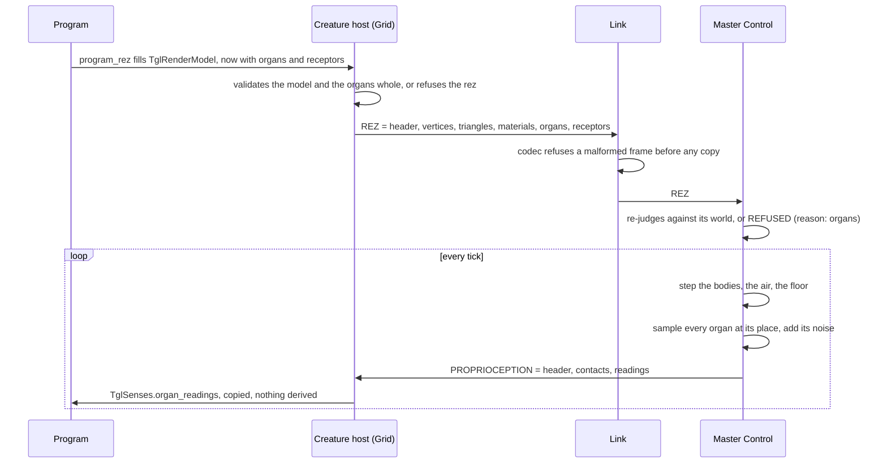
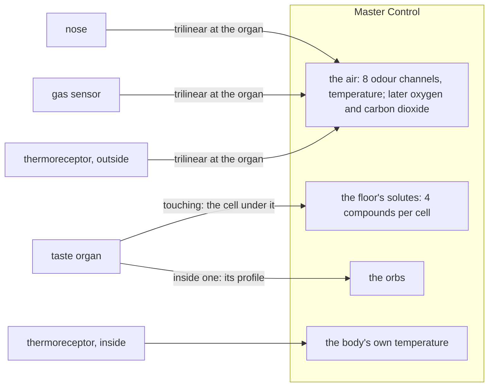
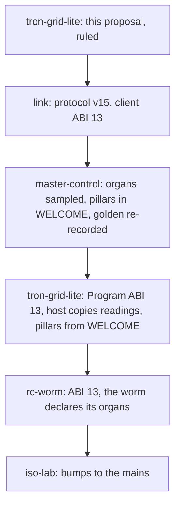

# Organs

> **Proposal, awaiting the owner's ruling.** Nothing here is built. It drafts the next cross-repo step the rulings of
> 2026-11-04 call for: one bump of the wire and of the Program ABI, in which a body declares its sense organs at `REZ`
> and the world samples its fields at those organs. Every number below is either cited, a chosen world setting said to
> be one, or marked *assumed*.

## Why this bump, and why one

Three rulings of 2026-11-04 end in the same sentence. Smell: "the sense organs become part of the body a Program
declares at `REZ`, as its servos are" ([CHEMORECEPTION.md § The air, the noses and the smoke](CHEMORECEPTION.md#the-air-the-noses-and-the-smoke-ruled-2026-11-04)).
Taste and the gases: each is "declared with the body like its nose" (the same document, its taste and gas sections).
Heat: the thermoreceptors arrive "on the wire and in the Program ABI, in the same bump as the noses' declaration"
([THERMORECEPTION.md § The build, in order](THERMORECEPTION.md#the-build-in-order), step 4). And the noise ruling puts the
organs' precision "in the same declaration ... one bump of the wire and the Program ABI for all of them"
([PERCEPTION.md § Imperfection at the body's own senses](PERCEPTION.md#imperfection-at-the-bodys-own-senses-ruled-2026-11-04)).
Master Control's issue [#91](https://github.com/ai-quokka-wannabe/master-control/issues/91) names this bump as the trigger
for the pillars to move onto the wire. So it is one bump: **protocol v15, client ABI 13, Program ABI 13**.

The world's half is mostly built. Master Control's air (`src/air.rs`) carries the odour (`src/odour.rs`) and the
temperature (`src/heat.rs`) on one 2 m grid with the risers as walls, sampled trilinearly at any point; the floor's
solutes (`src/solutes.rs`) are a field of four compounds on the same columns, read per cell. What is missing is the
other end: today the world samples the air at two amphids it places itself (`odour::amphids`, either side of the mouth,
a body's width apart), with eight receptor types and one affinity population it fixes for every body. That is the worm
written into the world - exactly what "the worm is the first body and the worked example, never the template" forbids.

## Scope

In:

- **The declaration**: what a body says about each organ at `REZ` - kind, place, receptors, noise.
- **The reading**: how the world's answers come back in the letter, and how `TglSenses` hands them to a Program.
- **The sampling**: which field each kind reads, where, and when.
- **The pillars on the wire** (master-control#91).
- **The worm's declaration**, as the worked example.

Out, each to its own step:

- **Body heat itself** (THERMORECEPTION.md step 3): each body's temperature stepped by its metabolism. This bump
  carries the sense of it and stages its value ([below](#the-bodys-own-temperature-staged)).
- **The gases in the air**: oxygen and carbon dioxide as tenants of Master Control's air. This bump carries the organs
  that read them and stages their value ([below](#gas-sensors)).
- **Vestibular and stretch precision**: their kind codes are reserved here and refused until their figures are sourced
  or assumed under the five conditions ([below](#kinds-reserved-for-later)).
- **The smoke and the aura**: the spectator's pictures of the fields, which need the fields on the wire, not organs.
- **Eyes and ears**: they stay in the Grid's descriptor (`TglCreatureDesc`), computed host-side, as today.

## The shape of it



## 1. The declaration

### What an organ is

An organ is **one kind of receptor at one place on one segment**. A real body's left and right amphids are two organs;
a mammal's two nostrils are two organs; an insect's six tarsi are six taste organs. An organ that reads several
chemicals does so through **receptor types**, rows of their own that organs point into, so the two amphids of a worm
share one table of eight types and a mammal's nostrils share one of many.

| Kind | Code | Reads | Readings per organ |
|---|---|---|---|
| Nose | 1 | the air's odour channels at the organ | one per receptor type: a bound fraction |
| Taste organ | 2 | the floor's solutes under the organ when it touches the floor, or an orb it is inside | one per receptor type: a bound fraction |
| Thermoreceptor | 3 | the air's temperature at the organ, or - inside the body - the body's own | one: kelvin |
| Gas sensor | 4 | one gas's fraction of the air at the organ | one: a fraction |
| *Vestibular* | *5* | *reserved: the precision of `specific_force` and `angular_velocity`* | *none of its own* |
| *Stretch* | *6* | *reserved: the precision of `joint_angles` and `joint_torques`* | *none of its own* |

### The rows on the wire

`REZ` keeps its order - header, vertices, triangles, materials - and two kinds of row follow: `organ_count`
`LnkRezOrgan` rows, then `receptor_row_count` `LnkRezReceptor` rows. The header grows by those two counts, 48 to 56 bytes.

```c
/* One organ: one kind of receptor at one place. Forty bytes, no padding. */
typedef struct LnkRezOrgan {
    float position[3];       /*  0  metres, in its segment's own frame (x right, y up, z backwards). */
    float size;              /* 12  metres: the receptive radius a nose or taste organ counts
                                    molecules over (Berg and Purcell). Zero for kinds 3 and 4. */
    float reach;             /* 16  metres: how near the floor a taste organ must be to touch it.
                                    Zero for every other kind. */
    float noise;             /* 20  one standard deviation: kelvin (kind 3), fraction (kind 4).
                                    Zero for kinds 1 and 2, whose noise is physics, not a claim. */
    uint32_t first_receptor; /* 24  its first LnkRezReceptor row (kinds 1 and 2); zero otherwise. */
    uint32_t receptor_count; /* 28  how many consecutive rows it reads through; zero otherwise. */
    uint8_t kind;            /* 32  LNK_ORGAN_NOSE 1, _TASTE 2, _THERMO 3, _GAS 4. 5 and 6 reserved. */
    uint8_t segment;         /* 33  which segment carries it: 0 the head, below segment_count. */
    uint8_t site;            /* 34  LNK_SITE_OUTSIDE 1, LNK_SITE_INSIDE 2 (kind 3 only, see below). */
    uint8_t gas;             /* 35  LNK_GAS_OXYGEN 1, LNK_GAS_CARBON_DIOXIDE 2 (kind 4); zero otherwise. */
    uint8_t noise_basis;     /* 36  LNK_NOISE_PHYSICS 1, _MEASURED 2, _ASSUMED 3: the label, recorded. */
    uint8_t reserved0[3];    /* 37  always zero. */
} LnkRezOrgan;

/* One receptor type: what it binds, and its population of affinities. 120 bytes. */
typedef struct LnkRezReceptor {
    float tuning[LNK_ORGAN_CHANNELS];                /*   0  weight per channel of its medium,
                                                              non-negative: the odour's 8 for a nose,
                                                              the solutes' 4 (sugar, salt, acid,
                                                              bitter) then four zeroes for taste. */
    float log10_affinity[LNK_AFFINITY_CLASSES_MAX];  /*  32  log10 of each class's K against the
                                                              medium's reference concentration;
                                                              class_count meaningful, the rest zero. */
    uint32_t class_count;                            /* 116 1 to LNK_AFFINITY_CLASSES_MAX. */
} LnkRezReceptor;
```

The channels are the world's chemistry, not anyone's receptors: Master Control's air carries eight odour channels
today (`odour::RECEPTOR_TYPES`, renamed for what it is) and its floor four compounds (`solutes::COMPOUNDS`). A receptor
with a one-hot tuning reads one channel, which is exactly what each of today's eight types does; a receptor tuned across
several reads a blend, as a real receptor binds more than one odorant. The affinities are declared rather than fixed
because the sensitive range is the organ's: today's one population - 21 classes, log-uniform over five decades centred
on the world's `HALF_SATURATION` ([CHEMORECEPTION.md § The receptors](CHEMORECEPTION.md#the-receptors),
master-control#87) - becomes the worm's declaration, and a body with a keener or a coarser nose declares its own.

### The caps

| Constant | Value | Why |
|---|---|---|
| `LNK_ORGANS_MAX` | 32 | the worm needs 13 ([below](#4-the-worms-declaration)); a mammal's skin of warm and cold spots or an insect's tarsi want more than 16 |
| `LNK_RECEPTORS_MAX` | 64 | the worm needs 9; generous for a mammal's nose at a worm-sized brain's scale |
| `LNK_ORGAN_CHANNELS` | 8 | the air's odour channels; the floor's four compounds fit in it |
| `LNK_AFFINITY_CLASSES_MAX` | 21 | today's population, four classes to a decade over five decades |
| `LNK_ORGAN_READINGS_MAX` | 128 | the sum of every organ's readings; organs may share receptor rows, so this is its own cap |

A maximal `REZ` grows from 45,616 bytes to 45,616 + 8 + 32 x 40 + 64 x 120 = **54,584**, under the framing's 65,535 with
room to spare; the static assertion that holds the largest frame says so.

### Validation

Link's codec judges the frame alone, single-pass and whole, before any copy - the gold-plating the one variable-size
client input already has. Master Control judges it again against its world and refuses by name. The creature host
judges the Program's arrays first, in the copy that already validates the model, and refuses the rez loudly.

1. **Counts first.** `organ_count <= LNK_ORGANS_MAX`, `receptor_row_count <= LNK_RECEPTORS_MAX`, and the frame length equals
   the header plus every row exactly - checked before any payload byte is read.
2. **A bodiless creature has no organs.** With no triangles, both counts are zero.
3. **Known kinds only.** `kind` in 1 to 4; 5 and 6 are reserved and refused at v15; anything else is refused. Every
   reserved byte is zero, and every float is finite.
4. **On the body.** `segment < segment_count`, and the position lies inside the model's bounding box - between the
   least and the greatest vertex coordinate on every axis. An organ is part of the body, never a probe held out from it.
5. **Per kind:**
    - *Nose and taste*: `receptor_count >= 1` and `first_receptor + receptor_count <= receptor_row_count`;
      `size` positive and no larger than the bounding box's diagonal; `noise == 0` and `noise_basis == PHYSICS`; `gas == 0`;
      `site == OUTSIDE`. Taste: `reach` positive and no larger than the diagonal; a nose's `reach` is zero.
    - *Thermoreceptor and gas sensor*: no receptor rows; `size == 0`, `reach == 0`; `noise` positive (no organ is
      perfect) and at least the kind's world floor ([open question 4](#8-open-questions)); `noise_basis` `MEASURED` or
      `ASSUMED`. Gas: `gas` in 1 to 2, `site == OUTSIDE`. Thermoreceptor: `gas == 0`.
    - *Inside*: only a thermoreceptor, only on segment 0, at position zero, and at most one per body - the body has one
      temperature.
6. **Receptor rows.** `class_count` in 1 to 21, unused affinity slots zero, every affinity within ten decades of the
   medium's reference; tuning non-negative and not all zero. A row read by a taste organ has zeroes past the fourth
   channel, and no row is read by both a nose and a taste organ - a row belongs to one medium. Every row is read by some
   organ: an orphan row is refused, so the frame holds nothing nobody means.
7. **Readings.** The sum over organs of their readings (receptor count for kinds 1 and 2, one for kinds 3 and 4) is at
   most `LNK_ORGAN_READINGS_MAX`.

A refusal by Master Control is a `REFUSED` letter with a new reason, `LNK_REFUSED_ORGANS` (5): "an organ is outside what
the world allows" - named apart from `LNK_REFUSED_BOUNDS` so the host can say which half of its body was refused.

### Noise: physics where there is physics, a declared figure where there is not

The noise ruling puts precision with the organ, and the labelled-assumptions ruling says how an unmeasured one may stand
in. This declaration keeps both without letting a Program buy precision by claiming it:

- **Chemoreceptors are noisy by physics.** A nose or a taste organ declares no noise at all: it declares its receptive
  radius, `size`, and the world counts molecules over it by Berg and Purcell's floor, as it does today with the
  constant `AMPHID_RADIUS` ([CHEMORECEPTION.md § The receptors](CHEMORECEPTION.md#the-receptors)). A bigger nose counts
  more and is less noisy, as a real one is; it can be no bigger than the body's bounding box.
- **Thermoreceptors and gas sensors declare a standard deviation**, with its basis recorded on the wire -
  `MEASURED` when a paper gives it, `ASSUMED` when the five conditions stand in for one
  ([PERCEPTION.md § Labelled assumptions](PERCEPTION.md#labelled-assumptions-where-biology-has-no-paper-ruled-2026-11-04)).
  The world never reads the basis; it is there so a Disk says which lives rest on an assumption, which is what
  condition 4 (swept, not tuned) needs to be checkable.
- **Every draw is from the RNG of record**, seeded per creature, tick, organ and reading -
  `reading_seed(creature_seed, tick, organ, reading)`, today's function with its amphid index generalised - so a life
  replays bit for bit and Clu re-simulates the same readings.

## 2. The reading

### Fixed slots or a variable block

| | Fixed slots | A variable block after the contacts |
|---|---|---|
| Shape | `float organ_readings[128]` in the letter's header, every tick, for every body | `reading_count` floats after the contact rows |
| Size | 512 bytes a letter whatever the body; the worm uses 27 | 4 bytes a reading; the worm's 27 are 108 bytes, its letter 168 to 220 |
| Parsing | no new length rule | the length rule gains a term; the count must equal the body's declared total, known since its `REZ` |
| Precedent | the joint slots (`LNK_SEGMENTS_MAX - 1`, zero beyond the chain) | the contacts (count in the header, rows after) |
| A slot nobody means | must be zero and checked, as the joint slots are | does not exist |
| Raising the cap | grows every letter | grows nothing until a body uses it |

**Proposed: the variable block.** The joint slots are fixed because a chain has at most seven joints and every chained
body has them; organs vary by an order of magnitude between bodies, and the contacts already show the variable form
works in this letter. The count is not a free variable: Master Control knows each body's total from its `REZ`, and
Link refuses a letter whose `reading_count` exceeds the cap; the host refuses one whose count is not its body's.

### The letter at v15

```c
typedef struct LnkProprioception {        /* 112 bytes, then contacts, then readings */
    uint64_t tick;                        /*   0 */
    uint32_t creature_id;                 /*   8 */
    uint8_t grounded;                     /*  12 */
    uint8_t reserved0[3];                 /*  13 */
    float specific_force[3];              /*  16 */
    float angular_velocity[3];            /*  28 */
    float joint_angles[LNK_SEGMENTS_MAX - 1u];  /*  40 */
    float joint_torques[LNK_SEGMENTS_MAX - 1u]; /*  68 */
    uint32_t contact_count;               /*  96 */
    float intake;                         /* 100 */
    uint32_t reading_count;               /* 104  floats after the contacts, <= LNK_ORGAN_READINGS_MAX */
    uint8_t reserved1[4];                 /* 108  always zero */
} LnkProprioception;
/* payload = 112 + contact_count * 52 + reading_count * 4; at most 112 + 832 + 512 = 1,456 bytes */
```

`odour[16]` goes: its sixteen floats become the first sixteen readings of a body that declares the worm's two amphids.
Readings come in declaration order - organ by organ, and within a nose or taste organ receptor by receptor - each
finite, a bound fraction in [0, 1], a temperature positive, a gas fraction in [0, 1], or the letter is refused.

### `TglSenses` at ABI 13

```c
typedef struct TglSenses {                /* 152 bytes, no padding */
    uint64_t tick;                        /*   0 */
    const TglEyeView* eyes;               /*   8 */
    const TglEarView* ears;               /*  16 */
    const TglContact* contacts;           /*  24 */
    const float* organ_readings;          /*  32  NEW: organ_reading_count floats, declaration order;
                                                    NULL when the body declared no organs */
    uint32_t eye_count;                   /*  40 */
    uint32_t ear_count;                   /*  44 */
    uint32_t contact_count;               /*  48 */
    uint32_t organ_reading_count;         /*  52  NEW: the same every tick of a body's life */
    float dt_seconds;                     /*  56 */
    float joint_angles[TGL_SEGMENTS_MAX - 1u];  /*  60 */
    float joint_torques[TGL_SEGMENTS_MAX - 1u]; /*  88 */
    float specific_force[3];              /* 116 */
    float angular_velocity[3];            /* 128 */
    float irradiance;                     /* 140 */
    float intake;                         /* 144 */
    uint32_t padding0;                    /* 148 */
} TglSenses;
```

`odour[TGL_AMPHIDS][TGL_ODOUR_RECEPTORS]`, `TGL_AMPHIDS` and `TGL_ODOUR_RECEPTORS` are removed: a Program that smells
declares its noses and knows where in its readings each one's types fall, because it wrote the declaration. The Program
declares through `TglRenderModel`, which already carries the body's non-render facts (`segment_count`,
`segment_spacing`), so it becomes the body a Program brings ([open question 2](#8-open-questions)):

```c
typedef struct TglRenderModel {           /* 72 bytes */
    const float* vertex_positions;        /*  0 */
    const TglRenderTriangle* triangles;   /*  8 */
    const TglRenderMaterial* materials;   /* 16 */
    const TglOrganDesc* organs;           /* 24  NEW: exactly LnkRezOrgan's shape, NULL when none */
    const TglReceptorDesc* receptors;     /* 32  NEW: exactly LnkRezReceptor's shape, NULL when none */
    uint32_t vertex_count;                /* 40 */
    uint32_t triangle_count;              /* 44 */
    uint32_t material_count;              /* 48 */
    uint32_t segment_count;               /* 52 */
    float segment_spacing;                /* 56 */
    uint32_t organ_count;                 /* 60  NEW */
    uint32_t receptor_row_count;          /* 64  NEW */
    uint32_t padding0;                    /* 68 */
} TglRenderModel;
```

The ABI's descriptors take the wire's shapes byte for byte, as `TglRenderMaterial` and `LnkRezMaterial` do, so the host
copies and converts nothing; the caps arrive as `TGL_ORGANS_MAX` and the rest, held equal to Link's by a static
assertion where the Grid speaks the wire.

## 3. What the world samples where

All of it after the tick's step, at the positions the step settled - exactly when `odour::sense` reads today. An organ's
world position is its segment's origin plus the segment's rotation applied to `position`, taken in one fixed order
(the forward term, then the right, then the up), f32, so it replays.



### Noses

The odour channels at the organ, trilinear between the eight cells around it (`Air::at`, as today). Each channel a
receptor type is tuned to is counted by Berg and Purcell's floor over the organ's `size` - in channel order, from the
reading's own stream - and the type's reading is the mean of `c / (c + K_i)` over its declared affinities, with
`c = sum(tuning[ch] * counted[ch])`. For a one-hot tuning this is today's arithmetic, channel for channel and draw for
draw; only the affinities change form, from today's literal quarter-decade table to `K_ref * 10^log10_affinity`, so
the worm's readings agree with v14's to the last few ulps rather than to the bit (a migration test holds them to that).

### Taste organs: the contact rule

A taste organ reads **only what it touches** ([CHEMORECEPTION.md § Taste](CHEMORECEPTION.md#taste-ruled-2026-11-04)):

- **Inside an orb** - the organ's position within an orb's radius of its centre, the mouth's own rule - it reads the
  orb's taste profile times the orb's content concentration (a world setting, chosen and said so in the PR that builds
  it).
- **Else, touching the floor** - its segment has at least one floor contact this tick, *and* the organ stands within
  `reach` of the floor surface beneath it - it reads the solutes of the floor cell under it (`Floor::at`).
- **Else it reads zero**, as a dry receptor binds nothing. That says no more than the touch sense already does: whether
  the segment is on the floor is in its contacts.

Counting noise as for a nose, with each compound's own diffusivity in water (`solutes::DIFFUSIVITY`). The floor's field
is a surface concentration, so a count needs a volume: the film of water an organ samples, a depth that is **assumed**
until read from a source, a named parameter beside its status ([open question 12](#8-open-questions)). The reference
concentration the affinities are relative to is the world's solute unit per square metre.

### Thermoreceptors

Outside: the air's temperature at the organ (`HeatField::temperature_at`, kelvin, the ambient added back), plus the
declared standard deviation times a standard normal draw (Irwin and Hall's, as the odour's counting uses). An organ
whose position falls below its column's floor reads the column's lowest air cell, as `Air::at` already clamps.

#### The body's own temperature, staged

Inside: the body's temperature, the interoception THERMORECEPTION.md rules in. It needs step 3 - each body's
temperature stepped by its declared metabolism and heat capacity - which is not built. The bump stages it so the wire
does not move again when step 3 lands:

- **From v15**, an inside thermoreceptor reads the air's temperature at the head's origin, plus its noise. That is the
  exact answer for a body that makes no heat of its own, and the worm's own physics in the limit the document describes
  ("its body temperature follows its surroundings"). Labelled in the code and the letter's comment as the
  zero-metabolism stand-in.
- **At step 3**, the same reading becomes the body's stepped temperature. No byte of the wire changes; the golden is
  re-recorded, as every change of the world's arithmetic is.
- The thermal make-up itself - metabolic heat, heat capacity - is **not** in this bump ([open question 11](#8-open-questions)).

### Gas sensors

The declared gas's fraction of the air at the organ, plus the declared noise, clamped to [0, 1]. Oxygen and carbon
dioxide are not yet tenants of the air, so the bump stages them as it stages the body's heat: **from v15 a gas sensor
reads the open air's value** - 0.21 oxygen, 0.0004 carbon dioxide, the values CHEMORECEPTION.md gives the grid's top -
which is the exact field of a world in which nothing breathes yet. When the tenants land, the same organ reads the solved
field; the wire does not move ([open question 6](#8-open-questions)).

### Kinds reserved for later

Vestibular (5) and stretch (6) organs will declare no place to sample and no readings of their own: they declare the
precision of senses the letter already carries - `specific_force` and `angular_velocity` for an otolith or a canal,
`joint_angles` and `joint_torques` for a stretch receptor - and the world adds that noise where it composes them. The
mammalian figures are sourced ([PERCEPTION.md](PERCEPTION.md#imperfection-at-the-bodys-own-senses-ruled-2026-11-04));
the worm's are not, and await the five conditions. The codes are reserved now so the row needs no new field then.

## 4. The worm's declaration

Thirteen organs, nine receptor rows, twenty-seven readings. Positions are in the head's frame (x right, y up, z
backwards; the nose is the joint tip at `(0, 0, -0.28)`, [rc-worm `docs/BODY.md`](https://github.com/ai-quokka-wannabe/rc-worm/blob/main/docs/BODY.md)).
`w` is the head's width, its hull's extent along x, as `odour::amphids` computes it today.

| # | Organ | Kind | Where (head frame, m) | Receptors / noise | Source, or *assumed* |
|---|---|---|---|---|---|
| 0, 1 | Left and right amphid (AWA and AWC lumped, as today) | nose | `(-w/2, 0, -0.28)`, `(+w/2, 0, -0.28)` | rows 0-7 shared: one-hot on channels 0-7, 21 classes at `log10 = n/4`, n = -10..10; `size` 4.48 mm | positions: CHEMORECEPTION.md ("left and right of the mouth ... a body's width apart"); five decades: Bargmann, Hartwieg and Horvitz 1993; `size`: today's `AMPHID_RADIUS`, *assumed* in place (an order of magnitude for the pore, master-control `src/odour.rs`) |
| 2, 3 | ASEL, ASER | taste | `(-w/2, 0, -0.28)`, `(+w/2, 0, -0.28)` | row 8: one-hot on salt; 21 classes over five decades centred on the reference; `size` 4.48 mm; `reach` 0.30 m | salt: Bargmann and Horvitz 1991, as CHEMORECEPTION.md cites; "ASE pair at the nose": CHEMORECEPTION.md; population, `size` and `reach` *assumed* |
| 4, 5 | AFDL, AFDR | thermoreceptor, outside | `(-w/2, 0, -0.28)`, `(+w/2, 0, -0.28)` | 0.01 K, `MEASURED` | 0.01 °C: Goodman and Sengupta 2018, as THERMORECEPTION.md cites ("a noise floor of about 0.01 °C"); read as one standard deviation, the leap PERCEPTION.md makes for vestibular thresholds, said so |
| 6 | Body temperature | thermoreceptor, inside | `(0, 0, 0)` | 0.01 K, `ASSUMED` | borrowed from AFD (condition 3); no paper measures a worm's sense of its own temperature apart from AFD |
| 7, 8 | URXL, URXR | gas: oxygen | `(-w/2, 0, -0.28)`, `(+w/2, 0, -0.28)` | 0.002, `ASSUMED` | URX reads rising oxygen: PMC3721734, as CHEMORECEPTION.md cites; place and noise *assumed* |
| 9, 10 | BAGL, BAGR | gas: oxygen | `(-w/2, 0, -0.28)`, `(+w/2, 0, -0.28)` | 0.002, `ASSUMED` | BAG reads falling oxygen: CHEMORECEPTION.md; place and noise *assumed* |
| 11, 12 | BAGL, BAGR | gas: carbon dioxide | `(-w/2, 0, -0.28)`, `(+w/2, 0, -0.28)` | 0.0001, `ASSUMED` | BAG reads rising carbon dioxide (GCY-9): CHEMORECEPTION.md; place and noise *assumed* |

The assumed numbers, each with its line of reasoning and its bounds (conditions 1 and 2):

- **ASE's `reach`, 0.30 m.** The real worm's nose lies on the agar; the Grid's head stands on a spike with its nose a
  circumradius (0.25 m) up, and its rails a little more ([rc-worm `docs/BODY.md`](https://github.com/ai-quokka-wannabe/rc-worm/blob/main/docs/BODY.md)).
  A reach just over that lets the nose taste while the head is down and not while it is lifted. Bounded below by the
  geometry (less, and the nose never tastes), above by the next segment's spacing (more, and it tastes from a body away).
- **ASE's affinities**: centred so a whole orb's settled ring, one cell out, binds half - the way `EMISSION` is
  calibrated for odour - and spread over the same five decades as the noses, for want of a measured range for salt.
- **The gas noises.** Oxygen: 0.2 percentage points, bounded above because the worm keeps to a 5 to 12 percent window
  ([PMC4500246](https://pmc.ncbi.nlm.nih.gov/articles/PMC4500246); [Gray et al. 2004](https://deepblue.lib.umich.edu/bitstream/2027.42/62676/1/nature02714.pdf)),
  which a sensor much noisier than a fraction of that window could not hold. Carbon dioxide: 0.01 percentage points,
  bounded above by the open air's 0.04 percent, which a sensor must resolve to tell a breathing patch from the air.
  Neither has a lower bound from biology; both are swept (condition 4).
- **Places.** URX and BAG are put at the amphids for want of a cited place; the error is a fraction of a head's width.

Two choices to note. The amphids stay lumped - one organ per side with all eight types, as today - so the bump changes
the plumbing and not the sense, and the migration test can hold the readings to v14's. Splitting AWA from AWC is then a
change to rc-worm's declaration alone ([open question 7](#8-open-questions)). And the worm tastes salt only: ASH's bitter
and the other amphid tasters are left for rc-worm to add, with sources, without touching the wire.

## 5. The pillars on the wire

master-control#91: `heat::PILLARS` is a hand copy of the flagship's `pillarPlacements`, two sources of truth for one
world fact. The doctrine is that Master Control owns the world, so the pillars move there and reach the Grid as the
reflection attenuation does - in `WELCOME`.

```c
typedef struct LnkWelcome {               /* 32 bytes, then pillar_count LnkPillar rows */
    uint64_t current_tick;
    float nominal_dt_seconds;
    uint32_t client_id;
    uint64_t world_fingerprint;
    float reflection_attenuation;
    uint32_t pillar_count;                /* was reserved0[4]; at most LNK_PILLARS_MAX */
} LnkWelcome;

typedef struct LnkPillar {                /* 24 bytes */
    float centre[3];                      /* metres, world: the box's centre, standing on its floor */
    float half_extents[3];                /* metres, each positive */
} LnkPillar;

#define LNK_PILLARS_MAX 16u               /* a largest WELCOME of 32 + 384 = 416 bytes */
```

- **Why `WELCOME`, not a message of its own**: a client cannot build its scene - the spectator's picture, the creature
  host's traced and heard stage - until it knows the pillars, and `WELCOME` is the one frame every client reads before
  anything else; late join stays not a special case. `WELCOME` becomes the fourth variable-size message, with the same
  exact length rule. A message of its own would keep `WELCOME` fixed at the cost of an ordering rule (open question 10).
- **What travels**: where and how big, already planted on the floor by Master Control (today `plantOnFloor` on the
  Grid's side and "the lowest floor its footprint covers" on the world's). Not the heat: the held excess is the world's
  physics, and no client needs it. Not the look: the pillar's material stays the Grid's, perception owned by clients.
- **Validation**: count within the cap, every float finite, every half-extent positive, every pillar inside the floor;
  otherwise the frame is refused, both ways.
- **Replay**: the Disk's header carries the pillars beside the attenuation, so a replay draws the world it recorded.
- **The Grid's copy goes**: the spectator and the creature host build their pillar boxes and their acoustic mirror faces
  from `WELCOME`. The reference render, which never joins a world, keeps a fixture of the same six, named as a fixture of
  that render and not the world.

## 6. The no-cheating audit

The standing audit ([PERCEPTION.md § Design rules](PERCEPTION.md#design-rules), and the rule CHEMORECEPTION.md and
THERMORECEPTION.md keep): for every new field, why a real body at its place would feel it, and that it leaks nothing
more.

| Field | Direction | A real body feels it because | It leaks nothing more because |
|---|---|---|---|
| The organ rows | Program to world | not a sense: the body's own anatomy | it flows away from the Program; the cheat it could buy is a privileged read, and validation closes that: on the body, at most its size, chemoreceptor noise from physics, no perfect thermometer |
| The receptor rows | Program to world | a receptor's binding is its chemistry | tunings name channels of the world's chemistry every animal shares, never an orb's pattern; affinities only set where a saturating reading sits |
| `noise_basis` | Program to world | not a sense | the world never reads it; it labels the Disk |
| A nose reading | world to Program | a receptor's bound fraction, as today | unchanged from v14: never a concentration, a direction, a distance or a label |
| A taste reading | world to Program | a receptor touching a solution reads what is dissolved in it | zero unless touching, and whether it touches is in its segment's contacts already; nothing at a distance; never which orb |
| An outside temperature | world to Program | a thermoreceptor transduces the temperature where it sits (Ramot 2008, as THERMORECEPTION.md cites) | one scalar at its own place: no gradient, no map, no warmest spot; two organs a head's width apart differ as little as the air does there |
| The body's own temperature | world to Program | an animal feels being cold or overheated | before step 3 it is the air at the head - a place the body occupies - so it is no more than an outside receptor there would feel |
| A gas fraction | world to Program | URX and BAG read oxygen and carbon dioxide tonically, as a level | one scalar at its own place; before the tenants it is the uniform open air, which is true and tells nothing of food |
| `reading_count`, `organ_reading_count` | world to Program | not a sense | the Program's own declaration, constant for a life |
| `WELCOME`'s pillars | world to clients | not a sense: no Program receives `WELCOME` | the Grid already draws the same pillars from its compiled copy; what any eye, ear or skin senses is unchanged |
| The relayed `REZ` | world to clients | not a sense | other hosts and spectators learn a body's organs, as they learn its mesh; no Program is handed another's `REZ` |
| `odour[2][8]`, removed | - | - | a field removed leaks nothing |

The audit also asks what a declaration could buy across organs. Noses along a whole chain are honest - fish taste over
their skin - and each reads only its own place; nothing says where a trailing segment is, so their difference is a
reading a Program must learn to use, not a position it is told.

## 7. Repos, PR order and goldens



1. **tron-grid-lite**: this document, ruled; TOPOLOGY.md and PROGRAM_INTERFACE.md follow in the build PR.
2. **link** (v15, client ABI 13): `LnkRez` 56 bytes with its two new row kinds; the letter's reading block; `WELCOME`'s
   pillar tail; `LNK_REFUSED_ORGANS`; the caps and the largest-frame assertions; the codec's refusals, each with a test
   red first; `LNK_AMPHIDS` and `LNK_ODOUR_RECEPTORS` removed; the Disk's header gains the pillars; the fingerprint moves.
3. **master-control**: `external/link` to v15, the mirror in `src/link_dll.rs` to client ABI 13 (its size assertions
   with it); a new `src/organs.rs` - the validation that re-judges a `REZ`, the per-kind sampling and the noise -
   replacing `odour::amphids` and `odour::sense`; `heat::PILLARS` becomes the world's own definition, sent in `WELCOME`;
   Clu reads organs from the log's `REZ`. Tests: the worm's declaration against v14's `sense` (to the last few ulps),
   the contact rule, the staged inside temperature and gases, every refusal.
4. **tron-grid-lite**: `external/link` to v15; `tgl_program_abi.h` to ABI 13 and its fingerprint; the roster validates
   organs in `copyValidatedModel` and sends them in `REZ`; `senses.cpp` points `organ_readings` at the letter's copy;
   the stage and the acoustic faces take the pillars from `WELCOME`; the probe Program declares no organs.
5. **rc-worm**: its ABI header copy to 13; `src/worm/body.cpp` declares the thirteen organs; the panel's smell display
   reads the first sixteen readings, and shows taste, warmth and the gases.

**What breaks, and when.** Every v14 client is refused at the handshake by fingerprint - refusal, not negotiation, and
0.0.0 owes no backwards compatibility. Every Program that read `odour` fails to compile against ABI 13. A Program that
declares no organs smells nothing, where today every body has two amphids for free. Old Disks and logs are refused by
the new Clu. Between Master Control's merge and the Grid's, the mains cannot talk; the window is meant to be one
evening.

**The golden's chicken and egg.** Master Control's chain golden (`tests/data/chain_life.log`) is a real life - rc-worm's
chain driven from its panel, through the Grid, recorded on the owner's desk - and Clu re-simulates it on every push. At
v15 its `REZ` carries the worm's organs, so it can only be recorded by a v15 rc-worm through a v15 Grid, which merge
after Master Control, whose CI needs the golden to pass. The way through, as at earlier bumps: link merges first; the
golden is recorded on the desk from the Master Control, tron-grid-lite and rc-worm branches built together against
link's merged commit, and committed in Master Control's PR; the Grid's and rc-worm's PRs then merge without moving it.
If either changes what it sends after the recording, the golden is re-recorded in a follow-up Master Control PR, never
hand-merged. The bodies' hash does not cover senses, so the readings themselves never move the golden; the `REZ` bytes
and the log's version do.

## 8. Open questions

1. **Who declares the organs: the Program or the Grid?** Eyes and ears are the Grid's descriptor ("the Grid decides the
   senses, the Program brings the body"), while the rulings of 2026-11-04 give each Program its nose. *Recommended*: the
   Program, as ruled - organs are anatomy, like the chain; eyes and ears stay the Grid's until their own trigger.
2. **Where in the ABI?** In `TglRenderModel`, or a third argument to `program_rez`. *Recommended*: `TglRenderModel` -
   it already carries the chain, and the vtable keeps its shape.
3. **Readings: a variable block or fixed slots?** *Recommended*: the variable block ([§ 2](#fixed-slots-or-a-variable-block)).
4. **A world floor under declared noise?** A thermoreceptor declared at 1e-9 K leaks nothing but is a superhuman organ.
   *Recommended*: yes - per kind, labelled assumed, a tenth of the finest figure the documents cite for any animal
   (0.001 K for heat, from AFD's 0.01 °C); for gases, a tenth of the worm's assumed figures until a measured one exists.
5. **The body's own temperature: an organ, or a field every body gets?** *Recommended*: an organ (inside
   thermoreceptor), so its noise is declared like every other's and a body without one simply does not feel it.
6. **Gas sensors before the gases are in the air?** Accept them and read the open air, or refuse them until the
   tenants land. *Recommended*: accept - the reading is true of a world where nothing breathes yet, and the wire does not
   move when the field arrives.
7. **The worm's amphids: lumped or split into AWA and AWC?** *Recommended*: lumped at v15, so the bump is proven not to
   change the sense; splitting is then rc-worm's alone.
8. **The contact rule for taste**: segment in contact *and* the organ within `reach` of the floor, with the Grid worm's
   ASE at its nose and a reach of 0.30 m (assumed). *Recommended*: yes; the alternative - ASE at the lowest spike, which
   touches - puts the worm's taste where its body is not.
9. **Relay the organ rows to every client?** *Recommended*: yes, the whole `REZ` - one code path, and the Disk and Clu
   need it; no Program sees another's `REZ`.
10. **Pillars: `WELCOME`'s tail or a message of their own; and the other fixtures?** The glass slabs and the glowing
    column are the Grid's copies too. *Recommended*: `WELCOME`'s tail, pillars only now - the slabs and the column
    follow when the world gives them a physical role (today the world knows the pillars only as heat).
11. **The thermal make-up (metabolic heat, heat capacity) in this bump or in step 3's?** *Recommended*: step 3's -
    `src/heat.rs` already shows a watt has no honest meaning on the scaled air, so its units want settling with the
    physics that uses them.
12. **Taste's counting noise**: Berg and Purcell with the compound's diffusivity over an assumed film depth.
    *Recommended*: yes, the depth a named parameter with its status, swept.
13. **The mouth as a declared organ?** Intake is the mouth's sense, and today the world places the mouth itself.
    *Recommended*: not in this bump - the mouth is the world's rule for eating, not a receptor; declare it when a body
    first needs a mouth somewhere else.

## References

As cited in [CHEMORECEPTION.md](CHEMORECEPTION.md#references), [THERMORECEPTION.md](THERMORECEPTION.md#references) and
[PERCEPTION.md](PERCEPTION.md#citations); this proposal adds none of its own. The ones it leans on:

- Berg HC, Purcell EM (1977). Physics of chemoreception. *Biophysical Journal* 20(2):193-219.
  doi:10.1016/s0006-3495(77)85544-6
- Bargmann CI, Hartwieg E, Horvitz HR (1993). Odorant-selective genes and neurons mediate olfaction in *C. elegans*.
  *Cell* 74(3):515-527. doi:10.1016/0092-8674(93)80053-h
- Goodman MB, Sengupta P (2018). The extraordinary AFD thermosensor of *C. elegans*. *Pflügers Archiv* 470:839-849.
  [PubMed 29218454](https://pubmed.ncbi.nlm.nih.gov/29218454/)
- Ramot D, MacInnis BL, Goodman MB (2008). Bidirectional temperature-sensing by a single thermosensory neuron in
  *C. elegans*. *Nature Neuroscience* 11:908-915. [PMC2504807](https://pmc.ncbi.nlm.nih.gov/articles/PMC2504807)
- Oxygen and carbon dioxide sensing in the worm: [PMC4500246](https://pmc.ncbi.nlm.nih.gov/articles/PMC4500246),
  [PMC3721734](https://pmc.ncbi.nlm.nih.gov/articles/PMC3721734), and
  [Gray et al. 2004](https://deepblue.lib.umich.edu/bitstream/2027.42/62676/1/nature02714.pdf).
